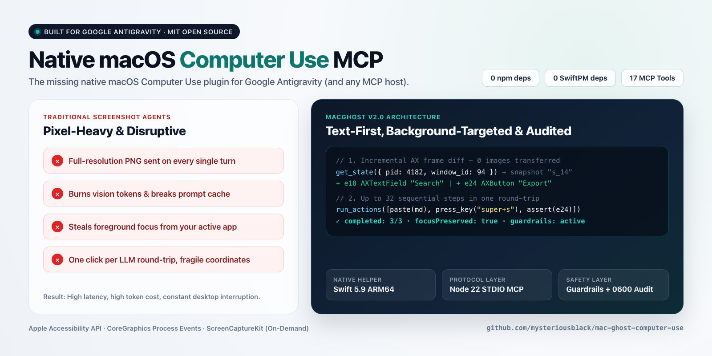

# MacGhost Computer Use

> **The missing native macOS Computer Use plugin for Google Antigravity (and any MCP host) — Text-Only AX Tree Diffs, 32-Step Action Batches, Focus Auditing, and Zero Dependencies.**

[](#quick-start)
[](#requirements)
[](#mcp-tools)
[](#architecture)
[](LICENSE)

[简体中文文档 (Chinese)](README_ZH.md)



---

## Why MacGhost?

**Google Antigravity** ships with powerful coding, terminal, and browser subagents — **but it does not yet ship with a native desktop Computer Use engine** for controlling local macOS apps (Finder, Notes, WPS/Office, MarginNote, Keynote, WeChat, etc.). Meanwhile, traditional screenshot-based Computer Use tools send megabytes of full-screen PNGs every turn, burn vision tokens, break prompt caching, and hijack your foreground window.

**MacGhost v2.0.2** fills that gap from scratch on native Apple APIs (`Accessibility`, `ScreenCaptureKit`, `CoreGraphics`) and a zero-dependency Node.js 22 MCP server:

- **Text-first, image-optional**: `get_state` reads a compact Accessibility (AX) control tree with stable `e<id>` refs and returns **incremental frame diffs** (`remove_ranges` + `upsert`) by default — zero image payload on normal UI workflows. Fall back to `capture_window` with normalized crops and `6×4` coordinate grids only for canvas or unlabeled surfaces.
- **Up to 32 steps per round-trip**: `run_actions` executes sequential actions, waits, and assertions (`ax_press`, `ax_set_value`, `click`, `scroll`, `type_text`, `press_key`, `paste`, `perform_secondary_action`, `drag`, `select_text`, `wait`, `assert`) in one MCP call, stopping immediately on stale frames or focus drift.
- AX reads, presses and value writes operate in the background. `paste`, `type_text` and `press_key` require a focused control in the target app. Their `posted_unverified` receipt confirms event posting only. Use an assertion or read back state to verify the effect. A canvas drag with `allow_activate: true` explicitly brings the target window forward.
- Legacy writes sample foreground focus before delivery, immediately afterward and after 150 ms. V2 samples again after UISettler’s 1–5 s observation period. Focus restoration is opt-in.
- Paste detects external clipboard changes and attempts to restore the original items while it still owns the clipboard. Inspect `receipts[].clipboardRestore`. HTML accepts attribute-free formatting tags.
- **Built-in guardrails & local audit**: Blocks sensitive targets (`SecurityAgent`, Keychain, Passwords, 1Password, Touch ID, Apple Pay, System Settings, CAPTCHA/payment prompts) via [`src/guardrails.json`](src/guardrails.json) and writes 0600-permission call logs to `.local/audit.jsonl`.
- **Zero external dependencies**: Pure Swift 5.9 (`swift build -c release`) + Node.js 22 standard library. No `npm install`, no Python runtime, no Electron overhead.

---

## Architecture

```text
MCP Host (Antigravity / Claude Desktop / Cursor / Codex)
   │  JSON-RPC over STDIO (zero npm deps)
   ▼
src/mcp-server.mjs  ──►  src/ax-state.mjs & src/run-actions.mjs
   │  Persistent local helper session + guardrail filter
   ▼
bin/mac-ghost-helper (Native ARM64 Swift binary, zero SwiftPM deps)
   ├── Accessibility API   ──► Compact AX snapshots, incremental diffs, AXPress / AXSetValue
   ├── CoreGraphics Events ──► Process-targeted clicks, scrolls, chords, multi-point drags
   ├── FocusGuard          ──► Legacy +150 ms / v2 UISettler focus audit & opt-in restoration
   └── ScreenCaptureKit    ──► On-demand cropped window PNGs with coordinate grids
```

---

## Requirements

- **macOS 14.0+** on **Apple Silicon (arm64)**
- Source builds require Xcode Command Line Tools with Swift 5.9+ and the macOS 14.2+ SDK.
- **Node.js 22+**

---

## Quick Start

### 1. Build & Verify

```bash
git clone https://github.com/mysteriousb1ack/mac-ghost-computer-use.git
cd mac-ghost-computer-use

# Compile the native Swift helper into bin/mac-ghost-helper
./build.sh

# Run native Swift unit tests and Node MCP protocol tests
./build.sh test
node --test tests/test_mac_ghost.mjs
```

### 2. Connect to Your MCP Host

#### Google Antigravity Plugin (One-Command Install)

```bash
# Preview installation plan first
./install_v11.sh --dry-run

# Close Antigravity, then install/upgrade with automatic backup
./install_v11.sh
```

#### Generic MCP Client (Claude Desktop / Cursor / Windsurf / Custom Host)

Add the following to your MCP configuration, replacing `/path/to/mac-ghost-computer-use` with your local clone path. Set `command` to the absolute Node executable path printed by `node -p 'process.execPath'`:

```json
{
  "mcpServers": {
    "mac-ghost": {
      "command": "/absolute/path/to/node",
      "args": ["/path/to/mac-ghost-computer-use/src/mcp-server.mjs"]
    }
  }
}
```

### 3. Grant macOS Permissions

Run `check_permissions` from your MCP host, then enable the host app in:

1. **System Settings → Privacy & Security → Accessibility** (for AX tree inspection & control actions)
2. **System Settings → Privacy & Security → Screen & System Audio Recording** (only needed if you call `capture_window`)

Restart the MCP host and re-run `check_permissions` after changing permissions. Basic AX operations require only Accessibility (`accessibility: true`). Event posting also checks `postEvents`. For screenshots, additionally verify `screenRecording: true`.

---

## MCP Tools (17 Total)

### Session & State (v2 Default Workflow)

| Tool | Purpose |
| :--- | :--- |
| `get_state` | Read compact text-only AX tree with `e<id>` refs; returns incremental diff by default (`full: true` for full tree). |
| `run_actions` | Execute 1–32 sequential steps (`ax_press`, `ax_set_value`, `click`, `scroll`, `type_text`, `press_key`, `paste`, `perform_secondary_action`, `drag`, `select_text`, `wait`, `assert`) with stale-frame detection & `focusAudit`. |

### Atomic v2 Actions

| Tool | Purpose |
| :--- | :--- |
| `type_text` | Single-line text entry into a referenced or focused control (rejects raw newlines). |
| `press_key` | Send xdotool-style chords (`Return`, `Tab`, `super+s`, `super+shift+Left`). |
| `paste` | Multi-format paste (`text` / `md` / `html`) with external-change detection and best-effort clipboard restoration. |
| `perform_secondary_action` | Invoke an explicit AX action such as `AXShowMenu` or `AXIncrement`. |
| `drag` | Smooth drag between two points or a multi-point stroke path (supports canvas drawing with opt-in `allow_activate`). |
| `select_text` | UTF-16 range text selection or cursor placement (`prefix`/`suffix` disambiguation). |

### Discovery, Vision Fallback & Classic Tools

| Tool | Purpose |
| :--- | :--- |
| `check_permissions` | Report macOS TCC permission states (`accessibility`, `screenRecording`, `postEvents`). |
| `list_windows` | List WindowServer windows with `windowId`, `pid`, bounds, and visibility (`app` filter supported). |
| `find_controls` | Native DFS search across AX controls by role, title/value substring, and action. |
| `inspect_ui_tree` | Read raw indexed AX hierarchy (`nodeId` paths). |
| `capture_window` | On-demand ScreenCaptureKit PNG with optional normalized `crop`, `6×4` coordinate `grid`, or `save_path`. |
| `ax_press` / `ax_set_value` | Direct AX press / value write by raw `nodeId` path. |
| `bg_click` / `bg_type_or_scroll` | Direct window-local CoreGraphics click, single-line text, or pixel scroll. |

---

## Standalone CLI Usage

`bin/mac-ghost-helper` can also be invoked directly from scripts and emits structured JSON on stdout:

```bash
./bin/mac-ghost-helper permissions
./bin/mac-ghost-helper windows --visible-only
./bin/mac-ghost-helper find-controls --pid 1234 --role AXButton --title-contains Save
./bin/mac-ghost-helper capture --window-id 42 --grid 6x4 --max-width 1440 --out ./window.png
```

---

## Security Guardrails

MacGhost enforces guardrails in both the Node server and Swift helper ([`src/guardrails.json`](src/guardrails.json)):

- Denies automation against Keychain, Passwords, 1Password, `SecurityAgent`, `System Settings`, Touch ID, Apple Pay, and detected payment / verification / CAPTCHA dialogs.
- Legacy coordinate writes require a verified AX hit in the requested window. Capture verifies the window tree before and after capture and refuses an incomplete inspection (192-node limit).
- Strips titles of protected windows from enumeration output.
- Logs timestamp, tool name, and outcome category only (no typed secrets) to `.local/audit.jsonl` (`0600`).

---

## License

[MIT](LICENSE)
