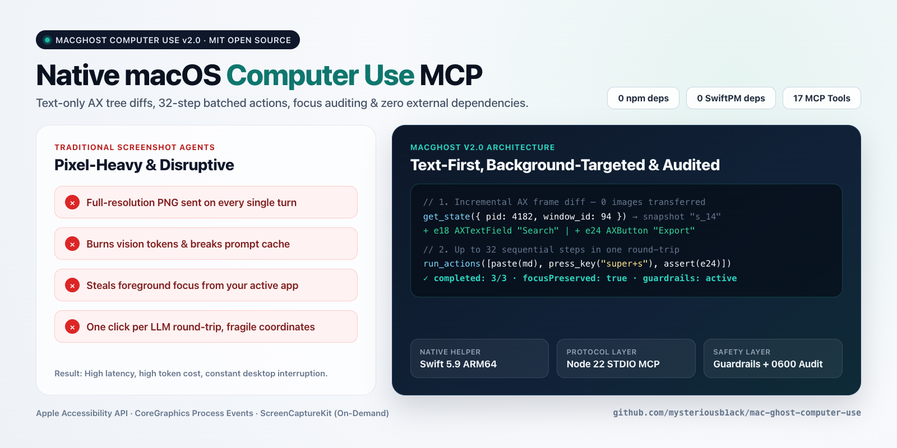

# MacGhost Computer Use（中文说明）

> **纯原生 macOS 后台 Computer Use MCP 服务：纯文本 AX 控件树帧间 Diff、单次 32 步动作编排、焦点漂移审计，零第三方依赖。**

[English README](README.md)



---

## 为什么做 MacGhost？

常见的桌面 Computer Use 方案每操作一步都要截一张整屏高清图发给大模型，既狂烧图像 Token、容易打穿上下文缓存，又经常直接抢占你的前台窗口。

**MacGhost v2.0** 完全基于 Apple 原生框架（`Accessibility`、`ScreenCaptureKit`、`CoreGraphics`）与 Node.js 22 标准库从零编写：

- **默认纯文本无图流**：`get_state` 读取紧凑 AX 控件树并分配稳定引用 `e<id>`，后续调用默认只返回相对上一帧的增量 Diff（`remove_ranges` + `upsert`），常规办公和桌面操作零图片传输。仅在画布或缺少 AX 标签时才按需用 `capture_window`（支持归一化裁剪和 `6×4` 网格坐标）。
- **单次 32 步批量连招**：`run_actions` 一次 MCP 调用即可串行执行最多 32 个步骤（支持点击、按键、富文本粘贴、选词、拖拽、等待、控件状态断言），遇到界面过期（`STALE_FRAME`）或焦点漂移自动停止不盲点。
- **后台定向与焦点审计**：按 `pid` / `window_id` 定向操控，每次写入自动在写入前、写入后及 +150ms 采样前台窗口状态（`focusAudit`），支持按需 `restore_focus` 恢复焦点。
- **剪贴板无损富文本粘贴**：`paste` 支持纯文本、Markdown 和 HTML 粘贴，并自动备份与还原用户原有剪贴板。
- **内置安全护栏与本地审计**：通过 [`src/guardrails.json`](src/guardrails.json) 自动拦截钥匙串、1Password、系统设置、Touch ID、支付确认与验证码窗口；调用审计以 `0600` 权限写入 `.local/audit.jsonl`。
- **零外部依赖**：纯 Swift 5.9 + Node.js 22 标准库，无需 `npm install`、无需 Python 运行时。

---

## 运行环境

- **macOS 14.0+**（Apple Silicon / ARM64）
- **Xcode Command Line Tools**（Swift 5.9+）
- **Node.js 22+**

---

## 快速开始

### 1. 编译与全量测试

```bash
git clone https://github.com/mysteriousb1ack/mac-ghost-computer-use.git
cd mac-ghost-computer-use

# 编译 Apple Silicon 原生 Swift helper 到 bin/mac-ghost-helper
./build.sh

# 运行 Swift 原生单测与 Node MCP 协议测试
./build.sh test
node --test tests/test_mac_ghost.mjs
```

### 2. 接入 MCP 宿主

- **Google Antigravity 插件一键安装**：
  ```bash
  ./install_v11.sh --dry-run   # 预览安装/升级计划
  ./install_v11.sh             # 关闭 Antigravity 后执行安装（自动备份旧版）
  ```
- **通用 MCP 客户端（Claude Desktop / Cursor / Windsurf 等）**：
  ```json
  {
    "mcpServers": {
      "mac-ghost": {
        "command": "node",
        "args": ["/你的本地路径/mac-ghost-computer-use/src/mcp-server.mjs"]
      }
    }
  }
  ```

### 3. 开启系统权限

在客户端调用一次 `check_permissions`，然后前往：
1. **系统设置 → 隐私与安全性 → 辅助功能**：勾选对应宿主应用
2. **系统设置 → 隐私与安全性 → 屏幕与系统音频录制**：仅在需要调用 `capture_window` 截图时勾选

重启宿主后再次调用 `check_permissions`，确认 `accessibility`、`postEvents`、`screenRecording` 均为 `true` 即可使用。

---

## 全部 17 个 MCP 工具速查

- **v2 会话与批处理**：`get_state`、`run_actions`
- **v2 原子动作**：`type_text`、`press_key`、`paste`、`perform_secondary_action`、`drag`、`select_text`
- **窗口发现、按需截图与基础操作**：`check_permissions`、`list_windows`、`find_controls`、`inspect_ui_tree`、`capture_window`、`ax_press`、`ax_set_value`、`bg_click`、`bg_type_or_scroll`

---

## 开源许可

[MIT License](LICENSE)
